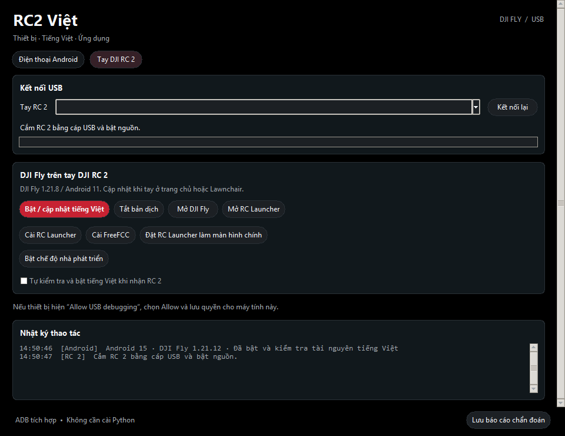

# RC2 Việt — bản public Basic 0.10.1

Công cụ Windows cho DJI RC 2 và Việt hóa DJI Fly trên điện thoại Android. Bản public **Basic 0.10.1** giữ luồng Việt hóa và menu **LED / HUD / xuất hình / radio**. Trong tab **Tay DJI RC 2**, hai thao tác riêng là **Cài / cập nhật menu** và **Bật / cập nhật tiếng Việt**.

Bản thử Advanced được giữ riêng ở thư mục cục bộ cùng cấp `rc2-viet-advanced-local` và **không được xuất bản**. Source/EXE public chỉ phân phối Basic; giao diện public không có bộ chọn Advanced. Mã thử, payload, APK riêng và khóa runtime/ký của bản riêng không thuộc gói public.

**Trạng thái xác minh — 13/10/2026:** EXE public 0.10.1 đã build và thử dựng/ký menu, Việt hóa từ APK gốc RC **1.21.8 và 1.21.10**. Basic 1.21.10 đã cài cùng chữ ký/giữ dữ liệu trên RC 2; menu không có Tiện ích SDK. Gói Việt hóa do chính EXE dựng đã được bật và đọc lại đúng tài nguyên trên tay. Công suất RF, xuất hình vật lý, thử bay và độ ổn định dài hạn chưa được xác minh.

## Menu và Việt hóa

**Cài / cập nhật menu** tự lấy APK `dji.go.v5` đang cài trên RC 2, kiểm tra nguồn/serial/metadata, phục hồi đúng nguồn nếu nhận diện được bản menu cũ, patch, căn chỉnh, ký và kiểm chứng trước khi cài. Menu phân tích Application, chuỗi kế thừa, điểm khởi động, DEX còn trống và ID giao diện. Không khóa số phiên bản Fly; cấu trúc hoặc contract chưa nhận diện được phải dừng trước cài.

Mỗi bản menu mới mang capsule phục hồi của chính APK nguồn. Phục hồi phải khớp SHA-256 nguồn rồi replay recipe và kiểm tra helper/chữ ký. Template cũ chỉ dành cho nhận diện bản lịch sử, không chứng minh tương thích phiên bản mới. Cùng signer có thể cập nhật giữ dữ liệu; khác signer vẫn cần sao lưu và xác nhận gỡ/cài, có thể mất đăng nhập hoặc khóa Keystore.

Menu trên tay có chạm hai lần trong preview để ẩn/hiện HUD, LED Trước/Sau và Bật hết/Tắt hết, lựa chọn xuất hình Có HUD/Không HUD, FCC và khôi phục vùng gốc. LED đọc trạng thái thật trước khi đổi, giữ các bit ngoài nhóm đã chọn, yêu cầu kết nối máy bay, telemetry hợp lệ/còn mới, mặt đất và động cơ dừng; ghi một lần rồi đọc lại. Radio giữ guard và baseline của đúng máy bay trong phiên, không đoán CE và không có keepalive.

Cầu SDK Basic tìm các key `Connection`, `IsFlying`, `AreMotorsOn`, `LEDsSettings` theo identifier có nghĩa thay vì phụ thuộc tên field bị đổi. Nó vẫn kiểm tra kiểu, chữ ký method/callback và quyền GET/SET; key thiếu hoặc trùng phải bị từ chối. Fixture đổi tên field là kiểm thử contract trên PC, chưa chứng minh ABI hay runtime của APK RC 1.21.10 thực tế.

**Bật / cập nhật tiếng Việt** dùng luồng riêng: APK đích → so khớp bộ nhớ dịch phù hợp → dịch phần thiếu bằng CPU trên PC → kiểm tra placeholder/markup/array/plural → dựng, ký và cài RRO chỉ chứa tài nguyên. RRO không thay APK/chữ ký/mã thực thi của Fly. Sau khi cài menu, phải lấy lại APK hiện hành để dựng đúng overlay.

Bộ nhớ dịch là tùy chọn; giữ bản dịch đã rà khi nguồn/contract khớp, dịch bổ sung khi không có cặp phù hợp. Bảng sửa cách diễn đạt của người dùng ưu tiên **Chế độ C (Tốc độ chậm)**; D-Cinelike vẫn là tên hồ sơ màu. Không dùng pin phiên bản cũ để ép tương thích và không cam kết 100% UI hoặc ngữ nghĩa mọi câu dịch máy.

EXE sử dụng engine dịch cục bộ đã kiểm tra hash; EXE đơn lẻ tải payload công khai khi thiếu, Portable kèm `translation-engine` để dùng ngoại tuyến. Nội dung APK được xử lý trên PC. Profile nền tảng hiện tại yêu cầu RC 2 / rc331 / Android 11 / API 30 có quyền shell root, hoặc điện thoại Android 15 / API 35 có root cho luồng Việt hóa. Công cụ không tự root thiết bị.

## Nguồn dữ liệu 1.21.10 và kết nối USB

Đã lấy APK gốc **1.21.10 / code 3115981** qua USB sau khi người dùng cập nhật; 468.109.376 byte, SHA-256 `f6c11267d465c303e2aecb737fe4f6b41b54da083368cac497404f4c9a464f98`, khớp báo cáo trong thư mục người dùng cung cấp. Menu Basic và RRO được dựng từ nguồn thật này, không dùng RedFly để dịch, patch hoặc cài. Bộ nhớ dịch và template bổ sung vẫn lấy từ `rc2-viet-codex-initial-release`; template legacy không thay thế APK gốc.

Lượt 0.9.0 từng thử cấu trúc trên **RedFly 1.21.10**, một APK mod của bên thứ ba. Kết quả đó chỉ là tham chiếu lịch sử, được loại khỏi bằng chứng tương thích với Fly RC 1.21.10 chính thức và Basic 0.10.1; nó không phải nguồn của luồng Việt hóa hiện tại. [Nguồn bộ nhớ dịch](assets/translation/memory/rc12110-supplement.provenance.json), [bằng chứng và trạng thái](docs/adaptive-menu-verification.json).

Discovery USB hỗ trợ chế độ DJI cũ **VID 2CA3 / PID 1021** và Android chỉ ADB **VID 18D1 / PID 4EE7**, được nhận diện sau cập nhật trong bối cảnh người dùng cung cấp. VID/PID chỉ giúp tìm transport; trước khi áp dụng vẫn phải xác minh model, device, SDK, root, serial, foreground và APK hiện hành.



Ảnh giao diện lưu từ bản cũ; không phải bằng chứng GUI/runtime của artifact 0.10.1 cuối.

[Báo cáo public Basic và lịch sử 0.9.0](docs/BAO_CAO_0.9.0.md) ghi rõ nguồn dữ liệu, ranh giới bản riêng và các bằng chứng còn thiếu.

## Tải và dùng

Source và EXE **Basic** là phạm vi phân phối GitHub đã được người dùng yêu cầu. Mốc tài liệu/source là **0.10.1**; metadata đóng gói dùng `0.10.1-local`. Chỉ nhận một EXE là bản mới sau khi [metadata build](dist/release-verification.json), [checksum](dist/SHA256SUMS.txt) và artifact cuối khớp nhau. Các liên kết [repository](https://github.com/GinzaTech/rc2-viet) và [GitHub Releases](https://github.com/GinzaTech/rc2-viet/releases) không tự chứng minh 0.10.1 đã được tải lên.

1. Mở EXE Basic hoặc giải nén Portable và giữ `translation-engine` cạnh EXE. Windows cần driver ADB/WinUSB phù hợp.
2. Nối USB dữ liệu, chọn đúng trang **Tay DJI RC 2** hoặc **Điện thoại Android** và đúng serial. Bấm **Allow USB debugging** trên thiết bị nếu được hỏi.
3. Với RC 2, giữ tay ở trang chủ/Launcher khi không bay. Có thể dùng **Cài RC Launcher**, **Mở RC Launcher** và **Đặt RC Launcher làm màn hình chính**.
4. **Cài / cập nhật menu** tự lấy và xử lý APK trên RC 2. Đọc xác nhận sao lưu/gỡ-cài khi khác signer; giữ cáp/nguồn tới kết quả cuối.
5. **Bật / cập nhật tiếng Việt** dựng RRO từ đúng APK hiện hành; **Tắt bản dịch** gỡ áp dụng overlay. Với điện thoại, dùng **Kiểm tra tương thích** trước.
6. Cài/mở FreeFCC là tiện ích riêng theo yêu cầu, không tự bật FCC. Developer options có cảnh báo về việc mất ADB nếu tắt USB debugging thủ công.

[Hướng dẫn](docs/USAGE.md) · [Menu/HUD](docs/HUD_APK.md) · [Android](docs/ANDROID_PHONE.md) · [RC Launcher/Home](docs/RC_LAUNCHER.md) · [Việt hóa](docs/VIETNAMESE.md) · [Build](docs/BUILD.md).

## RC Launcher mới

Source: [GinzaTech/rc-launcher](https://github.com/GinzaTech/rc-launcher), adaptation của Lawnchair/Launcher3, package riêng dev.rclauncher.rc2.debug. Icon trên dashboard lấy từ ứng dụng đã cài/chọn, không phải bộ glyph giả. Chạm mở đúng app, giữ để ghim. Menu ⋮ vào danh sách/cài đặt. Thanh trên hiển thị pinRC/Wi-Fi và **CPU / Pin** riêng.

CPU được đọc từ sensor cpuss/sysfs nếu app có quyền đọc; Pin là giá trị Android/driver pin báo. Đã thấy CPU khoảng87–95°C trong kernel trong khi pin báo30°C; chưa xác minh hiệu chuẩn firmware và không đo nhiệt độ vỏ. Không coi30°C là nhiệt độ toàn bộ tay hay chứng nhận không nóng.

Cầu Home3.0 ưu tiên RC Launcher debug, sau đó release; Lawnchair cũ chỉ là fallback nếu launcher mới không mở được. Đã kiểm tra Home từ Settings và sau reboot trên RC331/V14.00.00.04 test-keys, API30. Công cụ kiểm tra services.jar và APK trước khi đổi đường Home; không flash/sửa framework. Không gỡ Lawnchair tự động để giữ đường khôi phục.

## Gói nhúng

| Tệp | Vai trò / bản |
| --- | --- |
| rc-launcher.apk | RC Launcher mới, APK debug đã ký; version/hash trong manifest báo cáo phát hành |
| home-bridge.apk | Home3.0, đưa boot/Home vào launcher mới, có fallback |
| translation/ | Bộ nhớ dịch, bảng sửa cách diễn đạt và manifest engine; RRO mới được dựng từ APK đích |
| translation-engine/ trong Portable | Worker/model cục bộ có inventory/hash, dùng khi dựng bản dịch |
| freefcc.apk | FreeFCC1.5.5, tiện ích ngoài; chỉ cài/mở theo người dùng |
| lawnchair.apk | Lawnchair15 Beta3 upstream, chỉ giữ cho dự phòng/khôi phục |
| adb/ | Platform-tools nhúng + DLL, không phải driver tự cài |
| hud/ | Toolchain patch/ký, payload menu Basic và helper phục hồi; không chứa APK Fly nguồn hay khóa riêng |

APK debug launcher cài được. APK release unsigned của repo launcher phải ký trước khi cài; không nhúng bản unsigned vào EXE. Các APK intermediate và SystemUI reference trong artifacts/reference không dùng để cài hệ thống.

## Việt hóa DJI Fly

Chức năng **Bật / cập nhật tiếng Việt** cài một runtime resource overlay riêng, ánh xạ chuỗi/plural/array, giữ APK/chữ ký/mã thực thi của Fly. RC dùng idmapv4/Android11; điện thoại dùng idmapv9/Android15. Mỗi profile đối chiếu metadata/hash hiện hành, root, foreground và schema/path trước khi áp dụng; lỗi có rollback cache. Chức năng HUD riêng có sửa mã khởi động/manifest và ký lại APK Fly; gói do EXE tạo chỉ được dùng với tiếng Việt sau khi xác minh lại receipt và toàn bộ recipe.

Từ 0.8.0, luồng hiện hành dựng RRO từ APK đích thay vì cài gói dịch cố định 1.21.8/1.21.12. Bộ nhớ được so khớp, phần thiếu được engine dịch bổ sung trước khi kiểm tra và cài. Các APK RRO cũ trong cây tài nguyên là dữ liệu lịch sử, được loại khỏi asset stage desktop.

RRO không dịch HTML/server, chữ trong ảnh hoặc literal hardcode không nằm trong tài nguyên. Kiểm tra đủ tài nguyên và đúng contract không xác nhận ngữ nghĩa toàn bộ câu dịch, 100% UI hay độ ổn định bay.

## Kiểm chứng và giới hạn

| Phạm vi | Trạng thái |
| --- | --- |
| Menu public và cầu SDK theo identifier | Đã đối chiếu stock 1.21.8/1.21.10; Basic trên tay không có Tiện ích SDK, bật/tắt gesture và lưu lựa chọn xuất hình đã thử |
| Build/EXE cuối 0.10.1 | 2.003 test đạt, coverage Python 90,10%; GUI Basic-only, archive và hai phiên bản APK đã thử qua EXE |
| Basic 0.10.1 trên APK Fly RC 1.21.10 thực | Đã dựng/ký/replay/phục hồi đúng nguồn; đã cài giữ dữ liệu, mở menu và bật/đọc lại tiếng Việt |
| Chạm hai lần / HUD | Người dùng đã xác nhận ẩn và hiện lại trên Basic 1.21.10 |
| LED vật lý | 1.21.10: đã thử 6 thao tác trước/sau độc lập và cả hai; SDK đọc lại đúng, người dùng xác nhận đèn đổi đúng/kết nối ổn định |
| Xuất hình USB-C/HDMI và HDR vật lý | **Chưa xác minh**; driver, virtual display hay lưu lựa chọn chưa chứng minh tín hiệu/hình sạch |
| FCC | Bản cũ có override/readback và chỉ báo UI; công suất RF, hiệu lực, duy trì radio và khôi phục vùng gốc cần bằng chứng riêng |
| Thử bay, soak dài, mọi firmware | **Chưa xác minh** |

Bằng chứng hiện hành nằm trong [adaptive-menu-verification.json](docs/adaptive-menu-verification.json); các snapshot cũ chỉ áp dụng đúng bản đã ghi. ADB sau kết nối/reboot có thể cần Allow; công cụ không vô hiệu hóa vĩnh viễn yêu cầu xác nhận của firmware.

## Build

Windows, Python3.11 và JDK17 cho kiểm thử Java Home. Build EXE dùng toolchain HUD/APK đã có; muốn dựng lại toolchain cần JDK17, APKtool và Android build-tools. Khóa ký được tạo/lưu riêng theo tài khoản Windows khi chạy HUD; không đóng gói hoặc commit khóa.

```powershell
py -3.11 -m venv .venv
.\.venv\Scripts\python.exe -m pip install --upgrade pip
.\.venv\Scripts\python.exe -m pip install -r requirements-dev.txt
.\build.ps1
```

Gói public phải loại keys/.env/adbkey/phone-work/backups/cache và toàn bộ thư mục bản riêng. [Hướng dẫn build](docs/BUILD.md) mô tả kiểm thử, đóng gói Basic và việc giữ khóa ký ngoài repo.

## Nguồn và ghi công

- [RC Launcher source](https://github.com/GinzaTech/rc-launcher), [Lawnchair upstream](https://github.com/LawnchairLauncher/lawnchair), base78873fa3a8872eaee3e10211174cb5338c021a4f.
- [Lawnchair15 Beta3](https://github.com/LawnchairLauncher/lawnchair/releases/tag/v15.0.0-beta3.0), Apache2.0.
- [FreeFCC](https://github.com/doesthings/FreeFCC), [v1.5.5](https://github.com/doesthings/FreeFCC/releases/tag/v1.5.5), [website](https://freefcc.pages.dev/).
- [DJI Fly chính thức](https://www.dji.com/downloads/djiapp/dji-fly).

Dự án độc lập, không phải ứng dụng chính thức của DJI/Lawnchair. Giữ LICENSE/THIRD_PARTY_NOTICES.md và license của từng gói.

Android 11 trên RC 2 dùng `cmd overlay lookup PACKAGE PACKAGE:TYPE/NAME`, không có `--user`; Android 15 giữ `--user 0`. 0.10.1 sửa chọn cú pháp theo SDK để gói dịch đúng không bị rollback do lệnh đọc lại sai. Sau cài menu, giữ tay ở **Settings/RC Launcher** trong lúc Việt hóa; mở lại DJI Fly sau khi có kết quả thành công.
